# Decentralized Lost and Found DApp

A web app built on Ethereum for finding lost items on campus. When you lose an item, you post it with a cash reward that gets locked safely inside the code. When someone returns your item, you click a button to send them the reward. If it is never found, you can cancel the post and get your money back.

---

## 1. Problem Addressed

Traditional lost-and-found systems (like WhatsApp groups, notice boards, or help desks) have two big problems:

1. **Empty Promises:** Someone might spend time finding and returning your item, but you could simply walk away without paying the reward you promised.
2. **Untrustworthy Middlemen:** If a third party or desk holds the reward money, they can take a cut, delay payments, or misplace the funds.

**How this app fixes it:**
Instead of trusting a human or a company, the code acts as an automated digital lockbox:

* When you report an item, your reward money is locked inside the code immediately.

* The money cannot be stolen or touched by anyone else.

* It only moves in two situations: you give permission to pay the person who found it, or you cancel the post and get your money back.

---

### Summary of App Functionalities & Security Checks

#### 1. Report a Lost Item

* **What it does:** Allows a user to post an item they lost, provide a description, and deposit a reward in ETH directly into the contract’s balance.

* **What happens behind the scenes:** The contract assigns a unique tracking number (Item ID) to the report, records the owner's wallet address, stores the text details, locks the attached money, and marks the status as **Active**.

* **Safety Checks:**
* The title cannot be left blank.

* The user must send a reward greater than zero (no zero-value posts allowed).

#### 2. Pay the Finder

* **What it does:** Once the owner gets their item back in the real world, they enter the finder’s wallet address to release the locked reward.

* **What happens behind the scenes:** The contract updates the item’s status to **Claimed** so it cannot be paid out again, unlocks the reward, and automatically transfers the exact bounty amount directly to the finder’s wallet.

* **Safety Checks:**
* **Ownership Check:** Only the exact wallet address that created the post can trigger this payout (strangers cannot release or redirect the money).

* **Status Check:** The item must still be **Active** (prevents paying out a bounty that has already been claimed or cancelled).

* **Self-Payment Prevention:** The owner cannot enter their own wallet address as the finder to trick the contract.

* **Address Validation:** The finder's address must be a valid, real wallet address.

#### 3. Cancel Report & Refund

* **What it does:** If the owner finds the item themselves (or gives up), they can close the listing and reclaim their deposited reward.

* **What happens behind the scenes:** The contract marks the status as **Cancelled** and sends 100% of the locked bounty back to the original owner's wallet.

* **Safety Checks:**
* **Ownership Check:** Only the original poster can cancel the listing (an unauthorized user cannot cancel someone else's post).

* **Status Check:** The item must still be **Active** (you cannot refund an item that has already been solved and paid to a finder).

#### 4. View Item Details (Read-Only)

* **What it does:** Anyone using the website can type in an Item ID and inspect the listing details.

* **What happens behind the scenes:** The app directly asks the blockchain for the item’s stored information—showing the title, description, owner address, reward amount, and current status (Active, Claimed, or Cancelled).

* **Safety Checks:**
* The requested Item ID must exist (the app rejects requests for numbers higher than the total items created).

* Since this only reads data and doesn't change anything, it costs zero transaction fees and does not open MetaMask.

---

## 2. Deployment Details

* **Deployment Network:** Ganache Local Test Network
* **RPC URL:** `http://127.0.0.1:7545` or `http://127.0.0.1:8545`
* **Network / Chain ID:** `1337` or `5777`
* **Deployed Smart Contract Address:** `0xb5785b950D97413F5ab141768Fd1f41364dD30eD`
* **Solidity Compiler Version:** `0.8.28` (EVM Version: `paris`)

---

## 3. Prerequisites & Installation

### Requirements
* [Node.js](https://nodejs.org/) (optional, if using local HTTP server)
* [Ganache](https://trufflesuite.com/ganache/) (GUI or CLI)
* [MetaMask](https://metamask.io/) browser extension
* Modern web browser (Chrome, Brave, or Edge)

### Execution Steps

1. **Start Local Blockchain:**
   * Open Ganache and click **Quickstart**.
   * Confirm the RPC server port (default: `7545`).

2. **Configure MetaMask:**
   * Open MetaMask and manually add a new network:
     * **Network Name:** Ganache Local
     * **RPC URL:** `http://127.0.0.1:7545`
     * **Chain ID:** `1337` (or `5777`)
     * **Currency Symbol:** `ETH`
   * Import at least two test accounts from Ganache into MetaMask using their private keys (e.g., **Account 1** as Owner, **Account 2** as Finder).

3. **Deploy Smart Contract via Remix:**
   * Open [Remix IDE](https://remix.ethereum.org).
   * Create `LostAndFound.sol` and paste the contract code.
   * Under the **Solidity Compiler** tab, compile using version `0.8.28` with EVM version set to `paris`.
   * Under the **Deploy & Run Transactions** tab, select **Environment: Browser extension - Metamask**.
   * Deploy the contract and copy the deployed contract address.

4. **Connect Frontend:**
   * Open `app.js` and update `CONTRACT_ADDRESS` with your deployed address.
   * Open `index.html` in your browser (directly or via VS Code Live Server).
   * Click **Connect MetaMask** to link your account.

---

## 4. Transaction Evidence & Screenshots

### 1. Smart Contract Compilation
Successful compilation of `LostAndFound.sol` using Solidity Compiler v0.8.20:
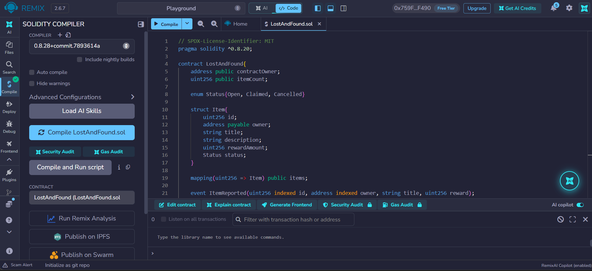

---

### 2. Smart Contract Deployment
Smart contract deployed to the Ganache network via Remix Injected Provider:
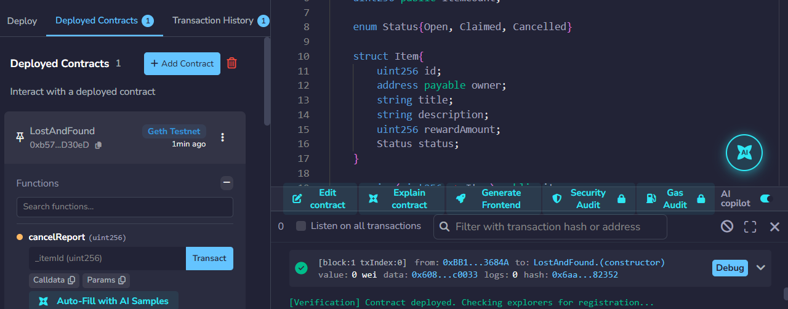

---

### 3. MetaMask Wallet Connection
Connecting MetaMask Account 1 to the frontend application:
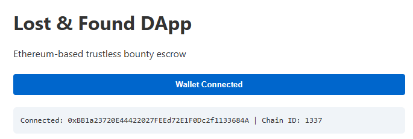

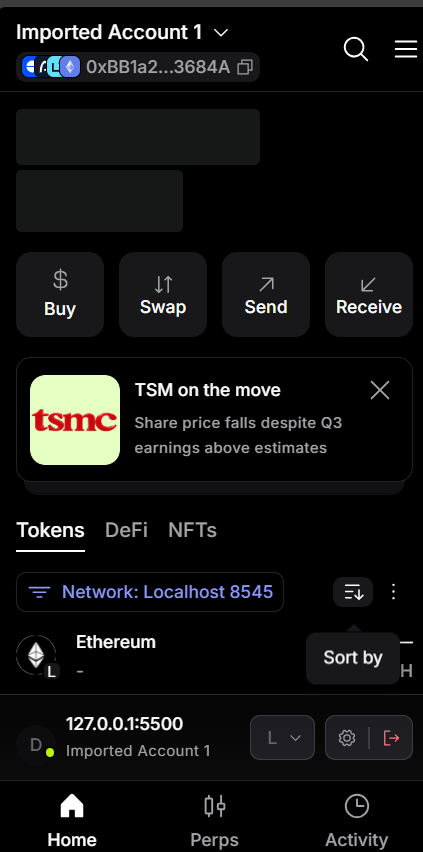

---

### 4. Successful Blockchain Transaction
Executing `payFinder`:
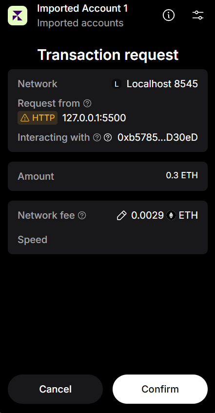

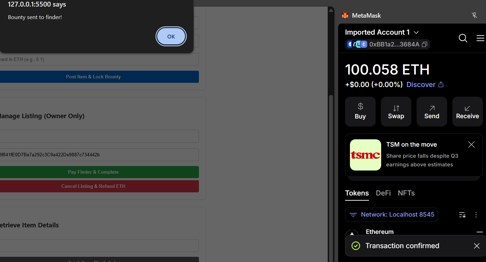

---

### 5. Failed / Reverted Transaction
Transaction execution rejected and reverted due to unauthorized access or invalid input:
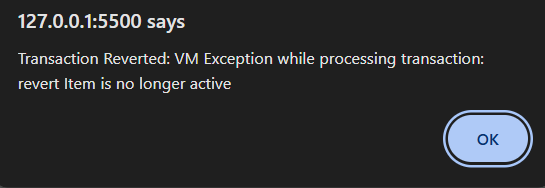

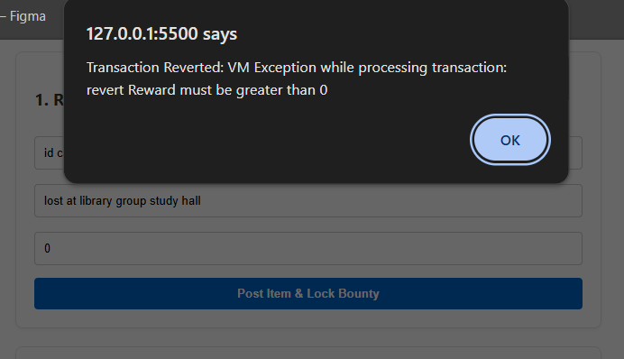

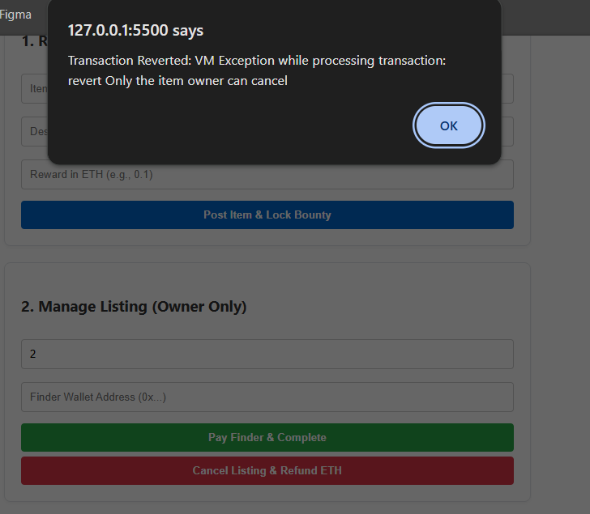
---

### 6. Blockchain Data Displayed on User Interface
Retrieving and rendering the immutable item details and status from the contract state:
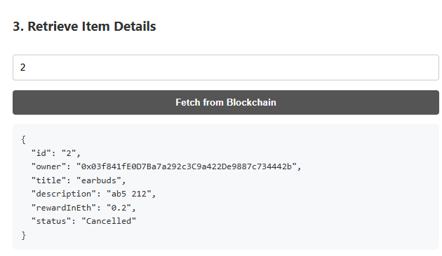

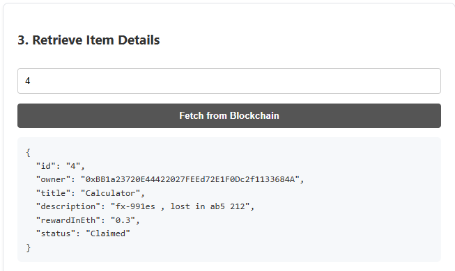

### 7. Transactions history

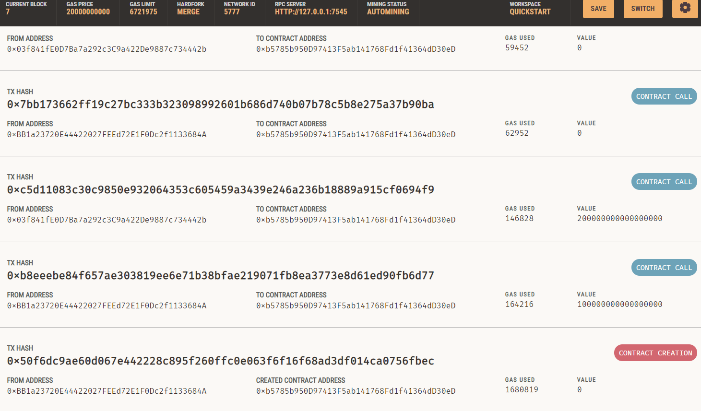
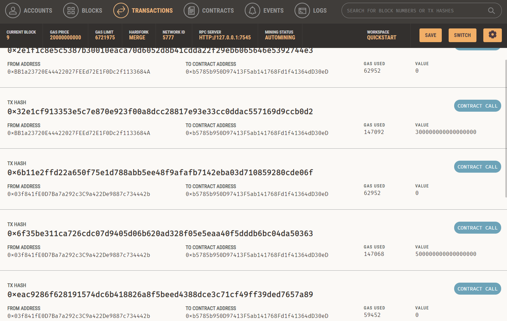
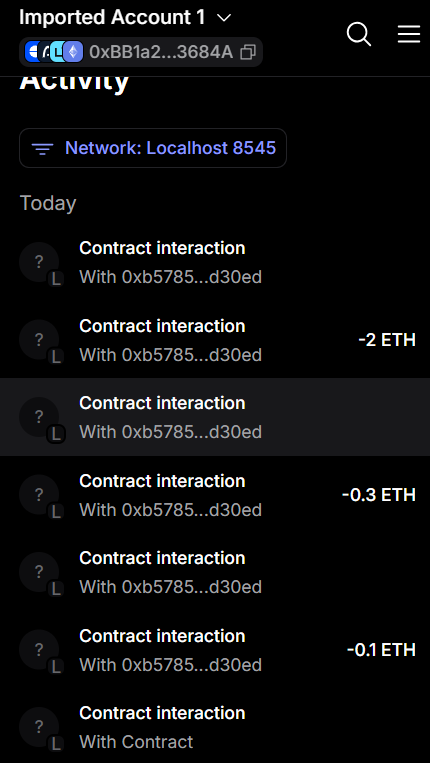

---
