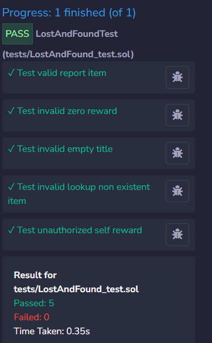

# Decentralized Lost and Found DApp - Test Plan & Results

This document contains the automated and manual test suite covering valid, invalid, and unauthorized inputs for the `LostAndFound.sol` smart contract.

---

## 1. Test Summary & Results Table

| Test ID | Test Category | Function Tested | Input Parameters | Expected Behavior | Observed Result | Status |
| :--- | :--- | :--- | :--- | :--- | :--- | :--- |
| **TC-01** | Valid Input | `reportLostItem` | `_title`: `"Student ID"`<br>`_description`: `"Food court"`<br>`value`: `1.0 ETH` | Item ID increments to 1, bounty is locked in contract balance, state is set to `Open`. | Bounty locked in contract; `itemCount` updated to 1; struct values match inputs. | **PASS** |
| **TC-02** | Invalid Input | `reportLostItem` | `_title`: `"Calculator"`<br>`_description`: `"Lab 302"`<br>`value`: `0 ETH` | Transaction reverts via `require(msg.value > 0)`. | Transaction reverted with `"Reward must be greater than 0"`. | **PASS** |
| **TC-03** | Invalid Input | `reportLostItem` | `_title`: `""` (empty string)<br>`_description`: `"Missing title"`<br>`value`: `0.1 ETH` | Transaction reverts via `require(bytes(_title).length > 0)`. | Transaction reverted with `"Title cannot be empty"`. | **PASS** |
| **TC-04** | Invalid Input | `getItem` | `_itemId`: `999` (non-existent) | Transaction reverts via `require(_itemId <= itemCount)`. | Call reverted with `"Item doesn't exist"`. | **PASS** |
| **TC-05** | Unauthorized | `payFinder` | `_itemId`: `1`<br>`_finder`: `address(this)` (caller/owner) | Transaction reverts via `require(_finder != item.owner)`. | Transaction reverted with `"Cannot reward yourself"`. | **PASS** |

---

## 2. Automated Solidity Unit Testing Code (`tests/LostAndFound_test.sol`)

The following test suite was executed in Remix IDE using the native Remix Solidity Unit Testing plugin:

```solidity
// SPDX-License-Identifier: MIT
pragma solidity ^0.8.20;

import "remix_tests.sol";
import "../LostAndFound.sol";

contract LostAndFoundTest {
    LostAndFound targetContract;

    // Allow contract to receive and handle ETH transfers
    receive() external payable {}
    fallback() external payable {}

    function beforeAll() public {
        targetContract = new LostAndFound();
    }

    // 1. VALID INPUT: Post an item with attached ETH bounty
    /// #value: 1000000000000000000
    function testValidReportItem() public payable {
        targetContract.reportLostItem{value: msg.value}("Student ID", "Found at food court");

        Assert.equal(targetContract.itemCount(), 1, "Item count should increment to 1");

        LostAndFound.Item memory item = targetContract.getItem(1);
        Assert.equal(item.id, 1, "ID should match");
        Assert.equal(item.title, "Student ID", "Title should match");
        Assert.equal(item.rewardAmount, 1 ether, "Reward should be 1 ether");
        Assert.equal(uint(item.status), uint(LostAndFound.Status.Open), "Status should be Open");
    }

    // 2. INVALID INPUT: Zero reward must revert
    function testInvalidZeroReward() public {
        (bool success, ) = address(targetContract).call(
            abi.encodeWithSignature("reportLostItem(string,string)", "Calculator", "Lab 302")
        );
        Assert.equal(success, false, "Should revert when reward is 0");
    }

    // 3. INVALID INPUT: Empty title must revert
    /// #value: 100000000000000000
    function testInvalidEmptyTitle() public payable {
        (bool success, ) = address(targetContract).call{value: msg.value}(
            abi.encodeWithSignature("reportLostItem(string,string)", "", "Missing title")
        );
        Assert.equal(success, false, "Should revert when title is empty");
    }

    // 4. INVALID LOOKUP: Non-existent item ID must revert
    function testInvalidLookupNonExistentItem() public {
        (bool success, ) = address(targetContract).call(
            abi.encodeWithSignature("getItem(uint256)", 999)
        );
        Assert.equal(success, false, "Should revert for non-existent item");
    }

    // 5. UNAUTHORIZED / REVERT: Owner cannot payout to themselves
    function testUnauthorizedSelfReward() public {
        (bool success, ) = address(targetContract).call(
            abi.encodeWithSignature("payFinder(uint256,address)", 1, address(this))
        );
        Assert.equal(success, false, "Should revert when owner attempts to reward self");
    }
}

```

